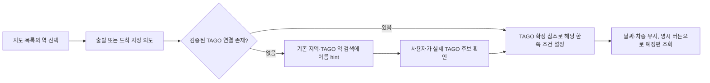

# 철도 역 안내→시간표 최소 연결 설계

> 후속 구현 상태: 단계 A의 이름 검색 의도·실제 TAGO 후보 확인 연결과 로컬 두 계층 검증은
> [별도 구현 원장](../reports/2026-10-28-rail-guide-station-intent.md)으로 정리했다. 아래 조사 당시의 미구현 기록은 source3f 기준 이력이며,
> 단계 B/API·시설·실제 UI 수용은 여전히 미완이다.

[현행 source·웹/Android/iOS 조사](../research/2026-10-28-rail-guide-connection.md),
[검증 범위와 구현 미완 gate](../reports/2026-10-28-rail-guide-research-validation.md)를 근거로 한다.

아래 이름/필드는 **제안**이며 현재 API·DB 구현이 아니다. 기존 지도 작업면/검색/시간표 배치와
Map/Common 형태·프로젝트 색상을 유지한다. 표시 상태는 필요한 곳의 i 안내로 설명하고 반복 문단을 늘리지 않는다.

## 1. 식별자와 연결 원칙

| 참조 | 확정 식별자 | 금지하는 변환 |
|---|---|---|
| 코레일 공개 안내 | `provider=korail_public_guide`, 원문 `provider_id=stationSeq` | 임시 `Place.id=index+1`을 외부 API나 DB ID로 전달하지 않음 |
| 코레일 좌표 파일 | 원문 `station_code=stn_cd` | TAGO `NAT…` 생성, KRIC 코드 생성 금지 |
| TAGO 시간표 | `provider=tago_train`, 원문 `station_id=nodeid` + 조회한 `city_code` 문맥 | 이름으로 ID 생성·다른 도시 후보 자동 지정 금지 |
| KRIC 도시철도 | 확인된 기관·노선·역 3코드, 기존 장소 ID·mapping revision | 역 번호/이름만으로 인증 코드 변환, KTX/SRT에 무조건 적용 금지 |

역 이름은 표시·검색 hint다. 같은 이름이 한 개라는 이유도 서로 다른 provider의 확정 교차표가 아니다.
공식 code 교차표 또는 근거·revision이 검증된 연결만 자동 지정할 수 있다. 현재 source에는 KORAIL→TAGO
교차표가 없으므로 첫 단계는 명시적인 TAGO 후보 확인을 사용한다. 한 사용자의 확인을 전역 교차표로 저장하지 않는다.
그 확인은 시간표 조건의 선택이지 두 provider 역의 물리적 동일성을 검증한 것이 아니다. Guide의 좌표·전화·시설을
선택한 TAGO 역의 공식 속성으로 복사하거나 외부 API에서 확정 결합 정보로 제공하지 않는다.

Guide→TAGO와 KRIC→도시철도 시간표는 서로 다른 연결이다. 일반철도 지도 임시 ID를
기존 `rail/timetables?place_ids=`에 전달하지 않는다.

## 2. 화면의 최소 변경



1. `GeneralRailGuide`에 `onStationIntent(role, source_ref)`를 추가하고 부모 Journey가 출발/도착
   상태를 소유한다. 선택 상세에 두 compact action을 둔다. 기존 anchor는 접근성/직접 이동용으로 유지한다.
2. 검증 연결이 없으면 기존 `StationSearch`를 재사용한다. 역 이름 hint를 넣되 실제 option을 선택하기 전
   departure/arrival은 확정하지 않는다. 이전 도시를 다른 지역으로 자동 변경하지 않으며 지역 선택이 필요하면
   그 입력으로 focus한다. 아무 후보나 첫 항목을 자동 선택하지 않는다.
3. 사용자가 TAGO 후보를 확인하면 그 provider/도시/ID로 해당 한쪽만 설정한다. 날짜·차종·반대쪽·지도 중심을
   보존한다. 같은 역이면 기존 조회 비활성화를 유지한다. 조건 변경의 취소/늦은 응답 방어와 명시 조회를 보존한다.
4. Guide 선택 key는 `(provider, provider_id)`다. Map의 숫자 rendering ID와 API 참조를 분리하고
   새 목록 순서/갱신에서 같은 숫자가 다른 역을 뜻하지 않게 한다. 전체 Map/Common를 재작성하지 않는다.
5. 시설 요약은 확인된 항목만 작게 보여준다. 미제공의 반복 문장은 `편의시설` 타이틀의 i 안내로 옮기고,
   선택한 provider의 공식 안내로 연결한다. 주소는 기존 지도 focus, 전화는 정확한 단일 전화번호일 때만 tel 링크다.
   전화 클릭 자동 실행·지도/외부 페이지 강제 열기는 하지 않는다.
6. 모바일은 지도 위에 새 큰 form/card를 누적하지 않는다. 역 지정 요청 때만 기존 시간표 조건으로 focus/이동하고
   닫거나 지도로 돌아오면 역·필터·중심을 유지한다. list/키보드에서도 같은 지정 action을 제공한다.

## 3. API의 같은 식별자 계약

### 3.1 Guide 응답의 additive 연결 정보

기존 `provider_id`, `station_code`, 이름/주소/전화/좌표는 유지한다. 첫 단계 제안:

```json
{
  "station_ref": {"provider": "korail_public_guide", "provider_id": "원문 stationSeq"},
  "timetable_link": {
    "status": "selection_required",
    "target": null,
    "query_hint": {"station_name": "표시 이름"}
  },
  "facility_status": "not_provided_by_source",
  "links": {"station_guide": "검증한 공식 URL"}
}
```

`verified`는 나중에 근거 있는 교차표가 생긴 경우에만 사용한다. 이때 target에는 provider·원문 TAGO
city/ID를, 연결 근거에는 공식 자료 URL/식별자와 revision을 포함한다. `selection_required`에는 target ID를
채우지 않는다. `unsupported`는 해당 서비스/참조를 현재 endpoint가 다루지 못할 때만 쓴다.
외부 API 소비자도 같은 상태와 후보 확인 절차를 사용할 수 있어야 한다.
공식 자료에도 여러 TAGO 후보가 대응하면 target 하나를 고르지 않고 명시 선택으로 남긴다.
후속 자동 연결의 revision은 양쪽 catalog와 교차표를 포함해야 하며 한쪽의 변경·폐지 이후 재검산 전에는 사용하지 않는다.

`station_ref`는 앞 표의 provider별 판별 가능한 객체다. 숫자로 변환하지 않아 선행 0을 보존한다.
`timetable_link.status`의 제안 값은 `verified | selection_required | unsupported`다. 여기서 unsupported는
해당 참조/서비스를 endpoint가 처리하지 못한다는 뜻이며 실제 역의 폐역·해당 열차 미운행을 뜻하지 않는다.

공식 URL은 허용 provider host와 확정 원문 ID에서 구성한다. 임의 URL을 요청 인자로 받아 서버가 fetch하지 않는다.
현 frontend의 provider URL 규칙을 중복 구현해야 한다면 SDK에 typed URL을 추가하는 작은 변경을 먼저 검토한다.

### 3.2 TAGO 후보 선택과 cold catalog

- `/stations`의 기존 city_code 문맥을 선택 객체에 보존한다. UI의 임의 index를 station_id로 사용하지 않는다.
- `/timetable`에 optional 출발/도착 `city_code` 문맥을 추가하는 호환 개선을 제안한다. 서버가 실제 city별
  catalog에서 원문 ID의 소속을 검증한다. 기존 warm-catalog ID-only 호출의 동작은 유지한다.
- 명시 도시가 있는 cold 호출은 필요한 catalog와 최대 두 도시의 station 목록만 기존 SDK/cache 보호 안에서
  확보한다. 모든16도시를 지도 선택마다 훑지 않는다. helper는 기존 query/cache 루틴을 좁게 재사용하며
  backend 내부 HTTP wrapper나 provider 파서를 만들지 않는다.
- 명시 도시가 없고 저장 목록에도 ID가 없으면 현재의 명시 오류를 유지한다. ‘없는 역’과 ‘확인 자료 미확보’는
  오류 사유에서 구분한다. 일시적 upstream 실패를 자동 역 교체나 정상 빈 시간표로 바꾸지 않는다.
- 날짜·등급·같은 출도착 검증, 기존 보호 간격/일일 상한·stale·truncated·Retry-After 의미를 보존한다.
  새 도시 문맥의 cache key/응답 schema는 기존 저장 JSON과 호환되도록 version 또는 optional 필드를 검토한다.
  정상 GET은 기존 애플리케이션의 provider 조회/조회 snapshot 저장을 수행할 수 있으며 ‘DB 무변경 API’라 표현하지 않는다.

### 3.3 공용 잠금의 재진입 금지와 한 요청의 총 예산

이 절은 P2 독립 검토에서 빠졌던 구현 제약을 보완한 **설계**다. 현재 `general_rail_routes.py:26–35`의
TAGO catalog/stations/timetable은 같은 `asyncio.Lock`을 사용하며 이 잠금은 재진입할 수 없다.
시간표 `query`가 잠근 상태에서 `fetch` callback이 다시 catalog/stations의 `query`를 호출하면,
선행 cache가 없는 경로에서 자기 잠금 해제를 기다리게 된다. 기존 코드는 그렇게 재귀 호출하지 않으며
이번 조사가 현재 deadlock을 실제 재현한 것은 아니다. 향후 cold 준비를 그 위치에 추가하지 않는다.

호출 순서는 다음으로 고정한다. 같은 `AsyncSession`의 dependency 준비는 병렬 실행하지 않는다.

1. 요청 입구에서 하나의 monotonic deadline을 정하고 cheap 문법·날짜·같은 출도착 검증을 먼저 한다.
2. 바깥 준비 단계에서 catalog `query`를 완료한다. 반환하여 TAGO 잠금이 풀린 뒤 city/grade를 검증한다.
3. 출발·도착의 명시 city를 중복 제거하고 안정된 code 순서로 최대 두 개만 준비한다. 각 stations `query`가
   cache 재검사·보호/SDK 호출·정상 저장을 끝내고 잠금을 해제한 뒤 다음 city로 진행한다.
4. 준비된 실제 목록의 원문 nodeid 소속을 검사하고, 미확정·불완전 자료라면 기존 오류/stale 의미를 명시한다.
   마지막으로 timetable `query`를 호출한다. 그 `fetch`는 시간표 SDK만 호출하고 다른 `query`를 호출하지 않는다.
5. 어느 단계도 TAGO 잠금을 쥔 채 router endpoint 또는 다른 operation의 `query`로 재진입하지 않는다.
   잠금 내부의 기존 cache 재검사·single-flight·TPS·일일 상한·Retry-After를 우회하지 않는다.

총 시간 예산의 제안은 기존 `settings.api_timeout_seconds` 한 값을 요청 전체 `T`로 쓰는 것이다
(고정3f 기본값15초; 이 문서가 운영 설정값을 재조회한 것은 아니다). catalog·두 city·시간표에 각각
새15초를 부여해 전체60초 이상으로 늘리지 않는다. cache DB 읽기, 공용 lock 대기, SDK TPS 대기,
내부 재시도/redirect/backoff, 응답 검증·정상 저장까지 같은 deadline의 남은 시간만 소비한다.
외곽 deadline과 각 SDK timeout의 min(기존 timeout, 남은 시간)을 함께 적용하며, 단계 전환·retry 때
deadline을 초기화하지 않는다. 대기 중 소진·취소되면 추가 SDK 호출을 시작하지 않고 session 정리와
잠금 해제를 보장한다. 취소를 빈 정상 시간표로 바꾸거나 provider 오류로 오인해 차단 시간을 임의 연장하지 않는다.
명시적 정상 과거 저장본의 기존 stale 반환 계약을 적용할 수 없으면 시간 예산 초과를504로 구분한다.

호출 수와 wall time을 따로 검산한다. 모두 cold인 두 도시 요청은 최대4개의 operation
(catalog1+stations2+timetable1), 최상위 SDK 메서드 최대5회(city/class 각1+station2+timetable1)다.
같은 도시는 한 번만 준비하고 cache hit은 provider 호출을 추가하지 않는다. SDK pin69c8의 transport는
transport 오류를 최대3번 시도하며 redirect도 공용 TPS를 소비하므로 **5 SDK 메서드가5 HTTP 전송을
뜻하지 않는다**. 현 router의 일일96은 cache-miss operation 카운터이고 HTTP retry 횟수의 정확한
일일 합계가 아니다. 그 기존 보호를 줄이거나 늘리지 않으며, 누적 HTTP 전송을 별도 hard cap해야 할
필요가 확인되면 SDK에 budget 계측/전달 계약을 보강한다. backend에 provider transport wrapper를 복제하지 않는다.

필수 회귀는 cold catalog→두 city→시간표의 잠금 획득/해제 순서, warm hit·같은 city 중복,
lock 대기/TPS·SDK retry를 합친 총 T 초과, 첫 준비 뒤 나머지 시간0에서 새 호출0, 요청 취소/이전 실패 뒤
다음 요청이 잠금을 얻는지, 일일 상한·429가 dependency 단계에서 걸리면 시간표 호출0인지다.
warm ID-only 호출의 기존 반환과 city/nodeid 소속 검증도 유지한다. 이들은 B 구현 전 필요한 회귀이며
이번 문서 작업에서 provider/DB 테스트를 실행한 결과가 아니다.

## 4. 시설·전화의 실제 보강 범위

| 현 자료 | 첫 단계 처리 | 추가 자료가 필요한 보강 |
|---|---|---|
| KorailPublicClient 전화/주소/공식 역 링크 | 현재 제공값을 compact하게 유지. 대표번호를 역 직통이라고 부르지 않음. 복수 번호/내선은 확인 전 자동 dial 금지 | 정확한 전화 분리·종류 모델이 필요하면 SDK에서 원문 보존과 typed contact를 추가 |
| 코레일 일반철도 시설 필드 없음 | `not_provided_by_source`; []로 시설 부재를 선언하지 않음 | 일반철도 역에 대응하는 공식 기계 판독 자료와 식별자·갱신/허용 계약부터 확인 |
| KRIC 파일1294의 제한적 긍정 시설 | `provided_partial`과 기준일·제공 범위. 항목이 비어도 ‘시설 없음’ 금지 | raw의 미기재/부정/미인식 의미가 필요하면 SDK typed 판정을 보강. 화장실 등 미지원 항목을 생성하지 않음 |
| KRIC `stationCnvFacl` | 현재 실제 수집/응답 계약은 `unverified`로 남김. 확정3코드가 있는 도시철도만 후속 후보 | SDK에서 공식 gubun/층/상세위치/교통약자 구분을 typed로 보강하고 요청 scope와 응답 ID를 검증. 실제 호출은 별도 기존 예산/48h 정책 안에서 검증 |
| SRT 전용역·공용역 | 현재 일반철도 Guide로 전체지원 주장 금지. 확인된 공식 안내는 해당 provider 문맥으로 연결 | SR 공식 자료/ID·일반철도와 metro의 시설 scope를 별도로 확보. KRIC metro 수서를 SRT 수서로 변환하지 않음 |

`facility_status`는 이 자료의 제공 범위를 뜻한다. `provided_partial`도 해당 역의 전체 시설/현재 가동/장애 없는
이동 경로를 보장하지 않는다. 공급자 미지원·아직 미수집·실패·확인된 부분 자료를 같은 빈 배열로 합치지 않는다.
실제 실패와 stale는 기존 응답/오류 계약을 유지하고, 보존된 정상 자료의 시점을 숨기지 않는다.

이 필드의 초안 값은 네 가지로 제한한다. `not_provided_by_source`는 현 feed가 해당 필드를 제공하지 않음,
`provided_partial`은 범위가 명시된 확인 자료, `unverified`는 실제 provider 계약 성공이 아직 미검증,
`not_collected`는 지원 계약은 확인했으나 해당 역의 저장 자료가 아직 없음이다. 검증 전 KRIC 시설 API는
`unverified`가 우선이며 단순 ‘미수집’으로 표현해 성공 가능한 계약을 이미 확인한 것처럼 만들지 않는다.
네트워크/파싱 실패는 이 enum으로 숨기지 않고 기존 오류·stale 계약을 따른다. 기존 코레일 Guide 저장 JSON을
읽을 때 새 optional 필드의 기본값은 `not_provided_by_source`, 연결은 `selection_required`이며 verified를 추정하지 않는다.

## 5. 작은 의존 단계와 파일 소유 후보

| 순서 | 제안 범위 | 완료 조건 |
|---|---|---|
| A | `general-rail-guide.tsx`, `general-rail-journey.tsx` 및 관련 frontend tests: stable source_ref·역 지정 의도·기존 TAGO 후보 명시 확인 | callback만으로 다른 역을 확정하지 않음. 기존 지도/필터/선택/시간표가 유지됨. 375/1440 모두 검증 |
| B | `schemas.py`, `general_rail_routes.py`, 관련 API tests: additive 연결/시설 상태·공식 링크, city 문맥과 bounded cold 검증 | 외부 API도 UI와 동일 TAGO 참조 검증. 기존 호출/캐시 응답 호환·호출 상한·오류 구분 확인 |
| C | SDK의 독립 변경이 실제 필요할 때만 `python-kric-api` typed 시설/전화·원문 계약, 이후 Transport pin/소비 코드 | 공식 자료·실제 응답 범위·offline fixture와 실제 수용을 구분. HTML 우회 없음. 일반철도/SRT 지원을 추정하지 않음 |
| D | 근거 있는 crosswalk가 확보된 뒤에만 canonical 연결 보존·revision/검산 설계 | 이름/거리 자동 연결0, 변동·중복·폐지 역/동시 수정 방어, 독립 리뷰 후 자동 지정 허용 |

A/B는 작게 이어서 구현할 수 있으나 A만으로 ‘자동 연결·API 동등 경험 완료’라 표현하지 않는다.
C/D는 지금 DB 테이블·수집 job·스케줄을 미리 추가하지 않는다. 기존 KRIC registry는 KRIC 3코드 매핑 전용이므로
코레일/TAGO 연결을 같은 JSON 형식에 억지로 넣지 않는다. source 조사 이후 Root가 구현 범위를 선택한다.

## 6. 필수 반례와 수용 목록

1. 이름이 같고 provider/도시/서비스가 다른 역, 서울 복합역·SRT/metro 수서: 자동 target 금지.
2. 코레일 stationSeq·stn_cd·TAGO nodeid·KRIC3코드·임시 Place.id가 같은 숫자 모양이어도 교환 금지.
3. 선행 목록 재정렬/재조회·역 삭제·중복 이름·주소/좌표 누락: 잘못된 다른 역 선택으로 바뀌지 않음.
   사용자가 다른 TAGO 후보를 명시 선택해도 기존 Guide 좌표/연락처를 그 역의 속성으로 이식하지 않음.
4. 출발 지정은 도착·날짜·차종을 유지, 도착 지정도 대칭. 같은 TAGO역/미확정 target은 조회 비활성.
5. 이전 조회 지연 응답/취소·조건 복귀·KST 날짜 변경: 잘못된 조건의 시간표를 성공 표시하지 않음.
6. cold catalog·확정 city의 다른 nodeID·stale/불완전 목록·429/실패: bounded 요청, ID 소속 검증, 임의 첫 후보/빈 정상 결과 금지.
   3.3절의 비재진입 잠금·dependency 순서·중복 city·총 deadline/실호출 구분·취소 후 해제 회귀를 포함한다.
7. Guide KTX/main 분류가 TAGO grade로 자동 변환되지 않음. SRT 전용/공용역과 지원 차종을 별도 실제 대조.
8. 시설 미지원·미수집·부분정보·실패를 구분. []≠부재, 시설 존재≠가동/무장애 경로. KRIC 결과 ID scope 불일치 거절.
9. 단일/복수/내선/주석 전화 원문 보존·정확한 tel href만 검증. 전화 실행0. 공식 링크 host/ID 대조와 외부 자동 이동0.
10. 키보드/list/위치 권한 거부·재시도·모바일 지도 면적/375px overflow·상세 focus/복귀 검증.
11. Root 기존 서울11/NAT010000→부산21/NAT014445 실제 경로는 후속 정상 GUI 수용에 재사용하되
    75/69를 고정 기대값으로 쓰지 않음. 실제 DTO의 날짜/원문 IDs/예정시각/이후 필터를 대조.
12. offline mocks·SDK 실제 조회·admin 실제 GUI·배포 소스를 서로 다른 증거로 기록. 시설API 실제 성공 미확인을 PASS로 바꾸지 않음.

이번 산출물은 조사 문서뿐이다. 코드·provider·DB·스케줄·운영·기존833 WT 변경은0이며 독립 리뷰 전 구현 승인으로 취급하지 않는다.
