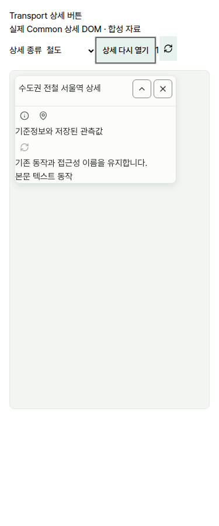
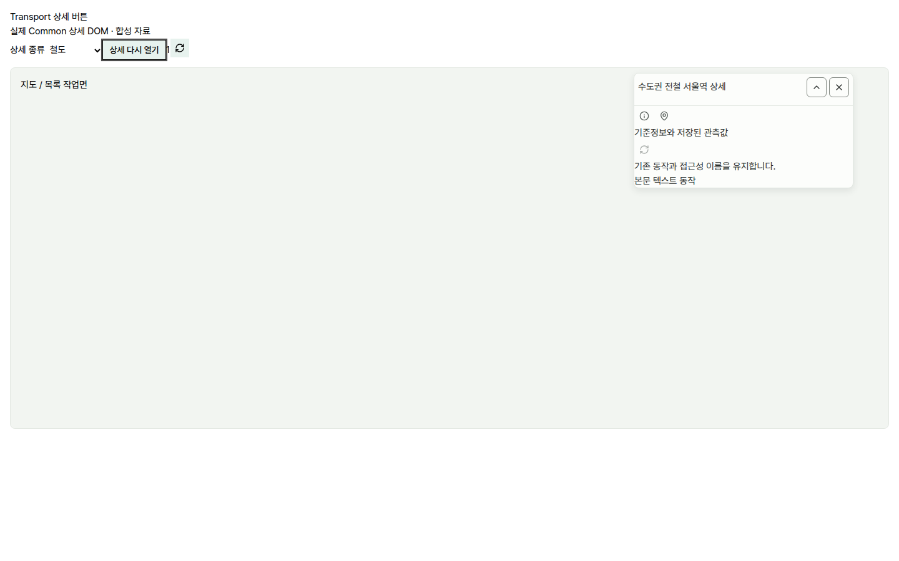
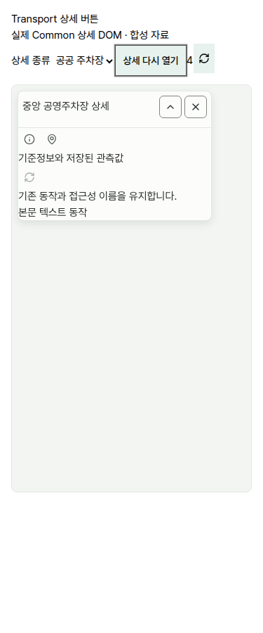
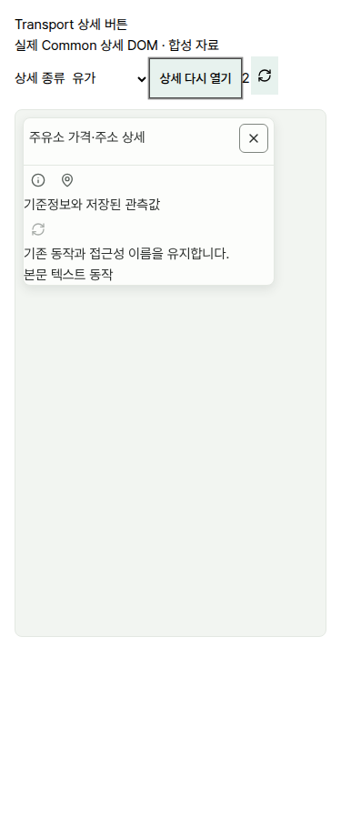

# 상세 아이콘 버튼 크기 통일

## 독립 리뷰 P1: 임베디드 상세 누락 후속

첫 후보b5a4811은 workspace 부모만 보았다. 실제 TransportMap109는 places가 있으면 MapWorkspace class를 embedded-map으로 바꾸고,517/521의 embedded/독립 상세는 모두 앱 고유 transport-map-detail을 사용한다. 따라서 초기9조건의 fixture가 모든 경우에 transport-map-workspace를 붙인 것은 철도/공공주차의 실제 embedded 소비 증거가 아니다. 원 후보·initial-workspace-only-after-results.json과 첫 캡처는 이 한계를 가진 원문으로 보존한다.

수정 전 실제 소비 class 조합인 kt-map-workspace embedded-map 아래 transport-map-detail만 둔375px/coarse에서 상세 접기가44px로 남는 RED/exit1을 재현했다. header/metadata에는32px selector가 닿지 않았으며 portal만32px였다. 최소 수정은32px 규칙의 부모를 transport-map-workspace에서 앱 고유 transport-map-detail로 바꾸는 것이다. 공용 CSS/설치본/지도 컨트롤/제품 JS는 그대로다.

수정 후 새 fixture는 부모 두 분기와 실제 aside class 차이를 그대로 사용한다. embedded-map + transport-map-detail은 철도/버스/공항/공공주차 ×1440/375/320font200%12조건, transport-map-workspace + transport-map-detail weather-inspector(유가fuel-inspector 포함)은9조건을 각각 통과했다. 총21조건은 header/metadata/info/portal32×32·SVG16, pointer hit-test·Enter/Space/포인터 접기펼침·정보창·주소링크·닫기/focus/disabled·overflow/pageerror0이다. 이것은 실제 Common DOM과 정확 소비 class의 합성 fixture이며 전체 제품 페이지/로그인 E2E로 확대하지 않는다.

기존 standalone E2E에 더해 실제 /parking-lots 페이지의 .embedded-map 상세를 여는375/1440 E2E를 추가했다. 타입·변경 spec lint·Common guard는0이다. 이 로그인 앱 E2E는 아직 실행하지 않았으며 실제 class fixture의 RED→GREEN과 구분한다. 새 원장은 browser/embedded-red-embedded-observed.json·failure.txt, after-embedded-results.json, after-standalone-results.json 및 p1-results.json이다. 아래 캡처는 후속12/9조건의 수정 후 파일로 갱신했다.

## 초기 구현과 검증 이력(위 P1 한계 포함)

사용자의 우선 요청에 따라 Transport 상세의 닫기·접기·정보/주소 아이콘을 PC와 모바일 모두32×32px, SVG16×16px로 맞췄다. 포털로 열리는 정보 팝업의 닫기X도 같은 기준이다. Weather는 별도 병행 범위다.

기존 실제 Common MapDetailOverlay와 앱 globals.css를 사용한 Linux Chromium156 fixture에서 PC는28/30/44px가 섞였고 coarse pointer에서는44px로 커지는 것을 재현했다. 앱의 상세 selector와 info-popup 닫기만 좁게 덮어썼다. Common 설치본·공용 CSS·지도 본체 확대/축소·필터/검색·일반 텍스트 행동·유가/기차/주차 데이터와 차트 로직은 변경하지 않는다. 버튼 이름·이벤트·키보드/disabled 계약도 그대로다.

실제 Common DOM/앱 InfoButton과 synthetic body를 사용한 fixture의 PC1440·모바일375·320px/font200%, 철도/유가/공공 주차3종 총9조건에서 대상32×32/SVG16을 측정했다. 포인터 hit-test, Enter/Space와 pointer 접기·펼치기, 정보창 열기/Escape·주소 링크, 상세 닫기·opener focus 복귀, disabled·가로 overflow0·pageerror0을 확인했다. 유가의 기존 접기 버튼 미제공은 유지한다. 대상 밖 검색 버튼은 coarse44px 및 font 확대를 그대로 따른다. 캡처는 운영 API/실제 로그인 수용이 아닌 합성 fixture다.

WSL TypeScript·변경 E2E spec strict ESLint·정확 Node22.23.1/npm12.0.1의 Common 의존성 guard는0이다. 기존 shared-map-ui E2E에 상세32px/16px·portal 닫기·Enter/Space 회귀를 추가했다. 로그인 앱 서버를 사용하는 그 전체 E2E는 이번에 실행하지 않았으며 위 실브라우저 fixture 검증과 구분한다. CSS-only 표시 변경 때문에 기존 DB/전체 차트 회귀·이미지/production 빌드·운영 배포·provider/키 작업은 실행하지 않았다. 새 설치는 없고 기존 QA 환경을 재사용했다.

Git 밖 원장은 transport-detail-buttons-qa/results.json 및 browser/{before,after}-results.json이다. 초기 fixture가 실제 Lucide .mjs 대신 없는 .js 경로를 가리킨 실패와 selector timeout은 남겼다. 경로를 고치고 소유 Vite만 새로 실행했다. metadata i의 캡처가 fixture header 제한 높이에 가려진 것을 보고 실제 소비처럼 body metadata 영역으로 옮긴 후 최종9조건을 다시 확인했다. 제품 markup 변경은 없다. 소유 fixture/브라우저 종료 후 다른 작업자 프로세스에는 신호를 보내지 않았다.

