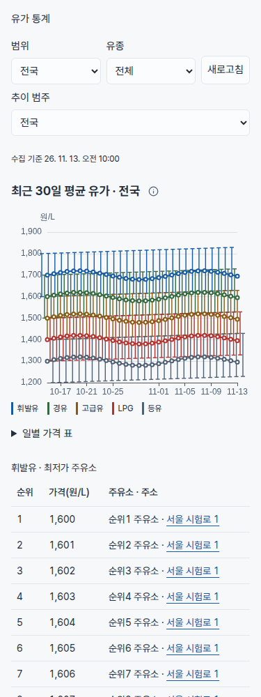
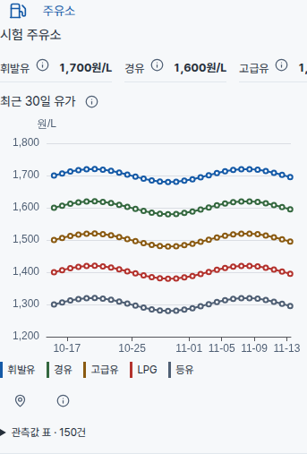
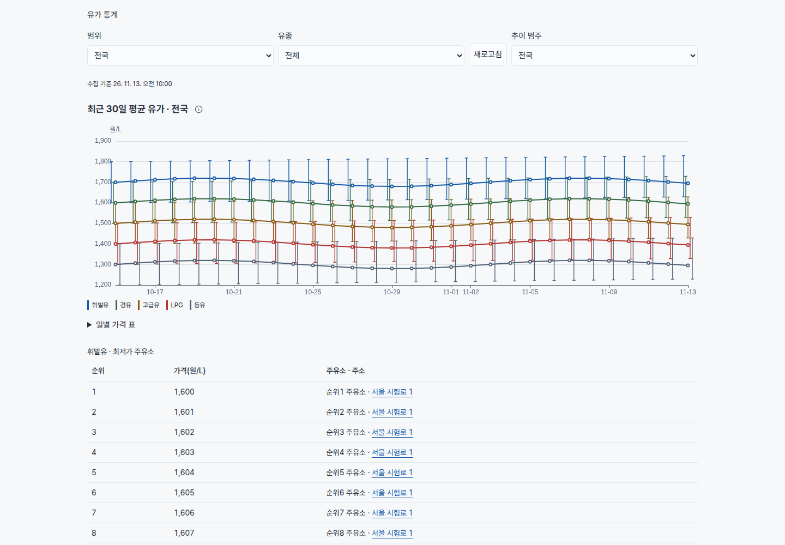
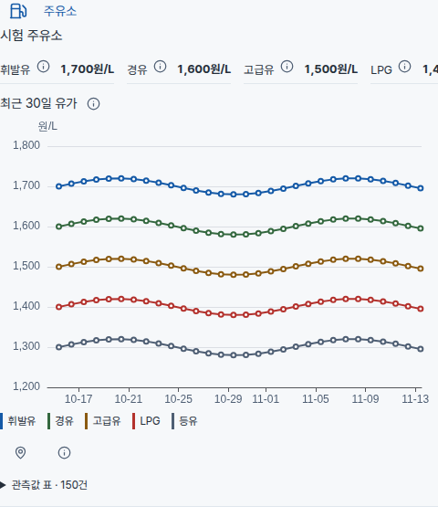

# 유가 30일·전체 유종·EvilCharts 구현 검증

## 반영 범위

사용자 요청 12~15를 유가 API·집계·관리 UI에 반영한다. 유가 통계는 30일 평균 선과 최저/최고 whisker, 모든 유종을 한 그래프로 표시한다. 범위·유종·추이 제어는 같은 행이고 모바일에서만 접힌다. 수집 기준은 작은 한 줄이며 통계 요약 박스를 제거해 그래프를 먼저 둔다. 가격순 최대 10곳과 주소 지도 링크는 휘발유·경유·고급유·LPG, 기존 등유 순서다.

주유소 상세는 현재 유효 가격 한 줄→30일 차트→주소/연락처/위치 근거→관측값 표 순서다. 실제 관측과 현재 읽기 모델 가격의 기준 시각이 다를 수 있음을 유지한다. i 안내에서 오래된 가격을 확인할 수 있다. 시간축은 실제 KST 간격이고 빈 날짜는 연결하거나 보간하지 않는다.

공식 EvilCharts의 Apache ECharts line/공용 소스 6개와 MIT를 재사용한다. 단순히 자체 ECharts wrapper에 이름을 붙이지 않는다. 앱의 시간축·whisker·툴팁은 공식 컴포넌트 chartOptions 확장점에 전달한다. 설치 출처와 원문/설치 SHA는 `vendor/evilcharts-fuel.json`에 있다. 공용 범례의 클릭 div만 native button으로 바꾸고 전체 표시의 aria-pressed를 보정했다. 그래프 키보드 날짜 선택도 native Button으로 제공한다. 일반 철도/해운 상세는 실제 유가 그래프가 생성되기 전까지 무거운 엔진을 적재하지 않는다.

## 데이터 보존과 읽기 계약

- 통계 API의 기존 B027 기본값은 유지하고 ALL을 추가한다. 공개 포인터·현재 범주·선택 범주의 30일 이력을 한 SQL snapshot에서 읽는다. ALL의 중복 범주 키는 DISTINCT로 제거하여 PostgreSQL scalar subquery가 여러 행을 반환하지 않게 한다.
- 일별 history에 product_code·minimum_price·maximum_price·cheapest_station을 추가한다. 해당 날짜에 저장된 값만 읽으며 없으면 null이다. 현재 최저가나 극값을 과거 날짜에 대입하지 않는다.
- 이번 성공 수집 시각과 FuelLatestPrice.collected_at이 같은 양수 가격만 게시하는 기준은 같다. 정상 게시 때 범주·유종별 10곳만 메모리에 유지해 순위를 저장한다. 이름/주소/좌표도 그 세대의 값을 함께 보존하므로 이후 기준정보 변경으로 과거 순위가 바뀌지 않는다.
- 과거 집계에 순위 배열이 없으면 기존에 알려진 cheapest_station+minimum_price 한 곳을 유지하고 추가 순위 미저장을 안내한다. 10곳을 가진 것처럼 꾸미거나 현재 가격을 이용해 과거 모집단을 재구성하지 않는다. 정상적인 다음 수집부터 순위가 축적된다.
- 일별/지역 집계는 영구 보존하며 조회 창만 30일이다. 개별 가격 이력 API는 기존 기본 7일을 유지하고 최대 30일을 허용한다. UI는 30일을 명시한다. cursor 창·revision·409 재시작·실패/미지원 원천은 기존대로 구분한다.
- 신규 마이그레이션 파일·운영 migration·원본/과거 세대 수정·운영 재수집/수동 게시·정리·prune·백업/복원 실행은 없다. 격리 시험 DB에는 기존 Alembic head만 설치했다. 운영/API 서버 배포 및 이미지/프로덕션 빌드도 없다.

## 검증

| 환경 | 결과 | 확인한 내용 |
| --- | --- | --- |
| WSL SQLite | 24개 통과, 413.94초 | 30일 경계·ALL·실제 극값/null·가격순 10곳·이전 수집 제외·과거 주소·오류/원본 보존·native 이력 |
| WSL PostgreSQL 18 | 24개 통과, 353.30초 | 격리 DB의 실제 SQL·API 계약 |
| WSL+Docker PostgreSQL 18 | 24개 통과, 312.51초 | 같은 집중 시험, 종료 후 정확 소유 CID/label 검산·테스트 DB 제거 |
| WSL/Docker admin | 각각 47개 통과 | 전체 유종·지표 누락·툴팁 수치/안전한 HTML·날짜 공백·주소 링크·순위·기존 오류/취소·상세 순서 |
| 최종 접근성/strict lint | 오류0·경고0 | vendor 6개·도메인 컴포넌트, native 범례/키보드 제어 포함 |
| TypeScript | 0 오류 | 변경 컴포넌트와 API 소비 타입 |
| Chromium 156.0.8078.4, 1440/375 | fixture 실제 캔버스 통과 | 2개 시간축 차트, 5유종×30일 선/whisker, 마우스/클릭 툴팁, 정확 금액·지도 링크, 각 10행 표, 원본 표 마지막, 현재가격 우선, pageerror0·가로 overflow0 |

각 환경은 같은 시험을 반복한 것이므로 숫자를 합산하지 않는다. 브라우저는 격리 fixture이고 운영 API·실제 로그인·DB를 함께 검증한 live E2E 증거가 아니다. 기존 live E2E의 7일/SVG/요약 박스 선택자는 새 계약으로 갱신했지만 운영 실행은 하지 않았다. 이미지/앱 빌드는 별도 담당 범위다. 운영 속도나 p95 개선율을 주장하지 않는다.

원장은 Git 밖 `weather-transport-evilcharts-20261112/fuel30-qa`와 `fuel30-pg-qa`에 보존한다. 핵심 기록은 `frontend-results-r7.json`, `strict-eslint-final.json`, `backend-sqlite.log`, PG `results.json`, `browser/final-results.json`이다. 초기 SVG/7일 기대치 불일치, JSDOM Canvas/ResizeObserver 부재, Docker 임시 mountpoint 부재, 지연 import 중 기본 5초 시험 timeout, 별도 fork worker 시작 60초 timeout은 원 실패로 남긴다. 최종 DOM 단위 시험은 엔진 경계만 대역 처리하고, 별도 옵션 검증과 실제 브라우저 캔버스로 보완한다.

초기 로컬 브라우저 Chromium1254/C 경로 profile의 SIGTRAP 및 기존 Firefox 프로토콜 불일치도 원 실패로 보존했다. 기존 Chromium1248 실행파일(실제 156.0.8078.4)과 소유 /dev/shm 임시 profile로 정상 확인했다. DrvFS의 Windows 편집은 기본 Vite watcher가 놓칠 수 있어, 최종 로컬 fixture는 polling과 새 서버의 실제 파일로 확인했다. 소유 QA 서버·브라우저·테스트 DB는 종료했고 다른 작업자/서비스에는 신호를 보내지 않았다.

## 화면

아래는 합성 fixture 화면이다. 운영 가격이나 실제 주유소의 수치를 나타내지 않는다.

## 남은 한계

과거에 기록되지 않은 Top 10은 즉시 채우지 않는다. 공급자 가격 오류를 임의 보정하지 않는다. 운영 배포/실제 API 통합 수용·main 머지는 Root가 별도로 정산한다. CI 원문 실패 조회와 후속 수정은 아래에 정산하며 독립 리뷰는 Root가 진행한다. 공항/항공편/고속도로/Weather/캐시 이전 요청은 다른 분담 범위이고 유가 기능으로 완료 처리하지 않는다.

## 최종 정산

제품 기준은 `03c0f396f62d350e0e057f362cd100db879bdd04`, [Draft PR190](https://github.com/digitie/kor-travel-transport/pull/190)이다. 최종 WSL/Docker의 47개는 29개 통계·7개 개별 이력·2개 상세·1개 chart 옵션·5개 cursor 모델·2개 시간축 모델·1개 범례 시험이며 같은 시험을 합산하지 않는다. `ruff --select F,E9`는 변경 백엔드/시험 파일에서0이다.

strict lint는 Weather에만 설치된 `react-x/no-children-for-each`를 가리키는 vendor 지시문 2개에서 실패했다. Root 승인에 따라 이 지시문만 일반 설명 주석으로 바꾸고 출처/설치 SHA를 갱신한 `800177dee27935fa3b92203a9a02e6dad091a0de`로 정산했다. 원 공식 Children.forEach와 런타임은 같다. 주석을 제거한 TypeScript JS 출력 SHA는 전후 `78abaaded9bcbda5dfa71a0e571bfebb6f4c81aef9c14534db52ab9e9911c5de`로 동일하며 `comment-runtime-equivalence.json`에 있다. 이 주석 수정 때문에 47개를 재실행하지 않았다. 최초 rule-definition 실패는 `eslint-vendor-rule-failure.log`, 후속 오류0·경고0은 `strict-eslint-final.json`으로 구분한다.

백엔드 집중 명령은 `python -m pytest backend/tests/test_fuel_statistics.py backend/tests/test_fuel_price_history.py -q`이다. 프론트는 `vitest run --maxWorkers=1 --pool=threads`로 위 7개 파일을 WSL과 동일한 Docker 컨테이너에서 실행했다. TypeScript는 `tsc --noEmit --incremental false`, lint는 `eslint --max-warnings=0`으로 vendor와 변경 도메인을 포함했다. 원 worker 시작 timeout·JSDOM 엔진/동기 검증 경계 실패도 보존한다. 운영용 이미지/앱 빌드·실제 API 통합 E2E·수집·재집계·배포·main 머지는0이다. 이후 CI·독립 리뷰·머지는 Root가 이어간다.

## 독립 리뷰 P1·원 CI 실패 후속

최초 CI `43331656574`의 backend/job131577577349는 정적 OpenAPI stale, admin/job131577576996는 full React Doctor의 vendor8개 경고로 실패했다. 원 `ci-43331656574-failed.log`를 보존하며 성공으로 바꾸지 않는다. frontend/common-policy는 성공, live E2E는 생략이었다.

James P1에 따라 정식 `scripts/export_openapi.py`를 명시 `DATABASE_URL=sqlite+aiosqlite:///:memory:` 환경으로 실행했다. 이전 `--check`의 실제1을 먼저 보존했고, 생성 후 WSL/Docker의 `--check` 모두0이다. `test_lifespan.py -k committed_openapi`의 사양/런타임 계약2개도 WSL2·Docker 각각 통과했다. Docker는 network:none·읽기전용 소스·in-memory SQLite로 실행하여 운영/기본 DB에 연결하지 않는다. 변경은 FuelRankedStation/FuelStatisticsGroup/FuelStatisticsHistory/FuelViewportStatistics와 유가2개 경로의 메타데이터뿐이며 총67개 경로를 유지한다. 정식 사양 SHA는 `443bdb9cbba4ca1d30589cfc050b92de61f1ac243e5bddf62f6e01c696e58123`, 원장은 `openapi-p1-results.json`이다. 기존24개를 이 이유로 재실행/합산하지 않았다.

Doctor의 실제 동작 문제는 공식 line helper 안에서 고쳤다. 전체 motion 대신 LazyMotion/m을 사용한다. 선택 callback은 state updater 밖의 event snapshot 경계에서 한 번만 실행하며 같은 batch의 두 클릭도 중간 선택을 잃지 않는다. loading RAF는 useEffectEvent로 최신 데이터를 읽는다. 고정 공식 compound API의 giant 선언1곳과 Brush/Legend의 의도적인 utility export4개만 각각 정확 위치의 근거 주석 예외로 남겼다. 광역 vendor 제외·config ignore·gate 완화는 없다. 출처/설치 SHA와 변형 이유는 같은 manifest에 기록했다.

실제 Chromium StrictMode에서 수정 전 두 클릭은 `[price,price,null,null]`과 다른 component를 render 중 갱신하는 경고를 만들었다. 수정 후 `[price,null]`이며 Loading overlay도 표시된다. StrictMode·같은 batch/최신 callback 회귀2개는 WSL/Docker 각각 통과했다. 이는 기존47개와 별도의 좁은 회귀이며 중복 합산하지 않는다. 최종 TypeScript/ESLint는0, React Doctor0.9.22 full은243파일·진단0·skippedChecks=[]·ok=true다. `doctor-fix-results.json`, `doctor-full.json`, `doctor-unit-results.json`, `strict-before.json`, `strict-after-final.json`을 구분해 보존한다. 최초 fixture resource404는 Next public 자산 경로를 제공하지 않은 검증 환경 문제였으며 최종 publicDir 연결 후 failedResources/errors 모두0이다. 보완한 helper의 실제 PC1440/mobile375 유가 캔버스·툴팁·키보드도 다시 확인했다.

이 후속 제품/사양 기준은 `f4cc5aad07ce2650fc74366622d5081d16f02667`이다. 800177d까지의 주석 동일성 검산과 달리 이 커밋에는 위의 실제 callback/Motion/EffectEvent 수정이 포함된다. 새 CI의 최종 상태는 이후 실제 원문으로 관측하며 자동 재실행이나 빌드·배포는 하지 않는다.

## main PR187 빌드 계약 통합

유가 기준 `2da65ed2110f3293a93a6cfae7f7ac3d61a1ba7c`를 로컬 보존 ref로 남기고 main `4b24e0de99fa13dacc0a349396769b8d07f414af`를 정상 merge했다. 충돌은 journal/resume/tasks 세 문서뿐이며 양쪽 이력과 실제 이미지/운영 수용 미완을 보존했다. main의 Node22.23.1/npm12.0.1·strict .npmrc·non-root Dockerfile·workflow·scripts는 해당 main bytes 그대로다. 유가 API/차트/벤더·기존 시험·Alembic·SDK/의존성 pin과67경로 사양의 제품 diff는0이다. admin lock의 모든 비root packages 엔트리는2da와 같고 root에는 main engines만 추가됐다. ECharts6.1.0/Motion14.12.0을 함께 유지했으며 install/upgrade0이다.

통합 집중 검산은 WSL의 정식 OpenAPI --check0, TypeScript0, admin/public Common 의존성/산출물 guard0, 선택한 빌드 계약4개 PASS, Node runtime 파일/권한 fixture19개 PASS다. 새 Node fixture는 실제 이미지/start/HTTP 수용이 아니다. 기존24/47개 및 별도2개 회귀는 이 metadata 통합 때문에 반복하지 않았다. 원장은 Git 밖 `fuel30-qa/main-integration-structure.json`, `main-integration-checks.json`, `main-integration-followup-checks.json`, `main-integration-posix-fixture-checks.json`이다.

초기 기본 npm11.19.1 관측을 보존하고 기존 cache의 npm12.0.1을 실제 Node22.23.1로 실행해 정확 버전을 검산했다. 공개 frontend는 로컬 node_modules가 없어 기본 npm script가 MODULE_NOT_FOUND였으며 설치하지 않았다. 동일한 설치된 Common guard를 공개 package/lock/artifacts/source 인자로 실행한 후속0을 별도로 기록했다. DrvFS 임시 Git/archive의 executable mode 대조2FAIL/2PASS도 원문으로 남겼다. 동일4개를 POSIX `/dev/shm`의 소유 임시 fixture에서 다시 실행해4PASS였으며 제품 guard를 완화하거나 소스/host 파일 권한을 바꾸지 않았다.

통합 전 head의 CI43335964564는 관측 시 admin/frontend SUCCESS, backend pytest 진행 중, live E2E SKIPPED였다. 통합 exact head의 최종 CI는 push 후 별도 실제 상태로 정산하며 미래 성공을 만들지 않는다. normal 이미지/production 앱 빌드·운영·수집/게시·백업/복원·main 머지는 실행하지 않았다.

## 공항 차트와 조합 통합

main4b24e0d를 가진 PR189의22888cae와 normal merge했다. 충돌은문서4개뿐이며
양쪽기록을보존했다. 유가/backend/API는716ed039와같고공개앱·빌드계약은22888와같다.
기존집중시험과독립두리뷰는각원후보의증거이며조합전체CI는별도다.

조합검사에서ignored local file: 설치복사본이오래돼parking-charts export를못찾는
타입오류1을확인했다. 정상strict/offline npm install은ERESOLVE로실패했고원실패보존,
--force·legacy-peer-deps·ignore-scripts우회0이다. pinnednpm12 pack뒤공식pacote.extract로
해당36파일만갱신하고전byte·peer·manifest/lock·제품/index불변을확인했다.
이는새CI의clean npm ci 성공과다르다. 새복사본으로타입·공통guard는WSL/Docker0,
Docker선택7PASS다. WSL원runner6PASS뒤worker-start오류1을보존하고미시도Fuel1개만
단독PASS했다. 깨끗한단일7PASS나기존24/47에합산하지않는다. 소유QA컨테이너잔여0.
원장은fuel-airport-integration-qa-20261113/installed-copy-refresh-final-receipt.json이다.

추가수집/통계확인은기존짧은게시잠금·동일성공모집단·원자게시·공항지연관측무효화·
고속도로원본/5분집계같은TX를확인했지만운영성공을소급하지않는다. 새실제재현P2는
동일수집stamp의구모집단정정직후지도cache가최대10초이전값을반환하는경계다.
TTL만료후일치하고새정기성공세대는즉시새key를쓰므로일반게시실패와구분한다.
기존state에는정정revision이없으며이10초계약만으로새DB열·매요청스캔을추가하지않았다.
정정검산은10초뒤같은bounds/query로DB/page/지도를대조하고,그뒤불일치는새오류로본다.
원장은transport-collection-robustness-evidence/findings.md다. 게시실패가다음정상수집까지
대기할수있는기존한계(유가8시간)와실제고속도로원천오류/마지막성공검산은운영담당의잔여다.
이번제품·DB스키마·원본·통계원장변경0이며실DB·외부수집·재게시·스케줄·prune0이다.